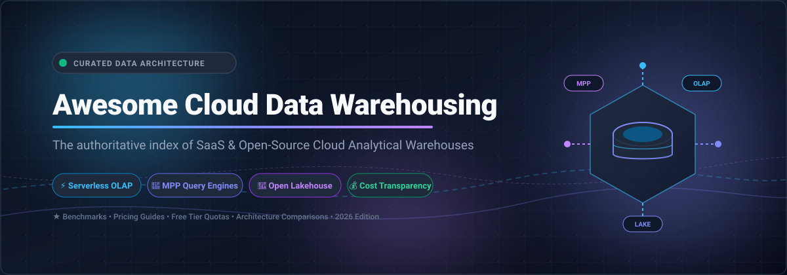

# 🚀 Awesome Cloud Data Warehousing Standard

  

  
  
  
  
  
  
  

---

> ⚡ **A curated directory and standard guide for Cloud Data Warehousing, Modern Analytical Databases, Serverless SQL Engines, and High-Performance Open-Source MPP Infrastructure.** 🌟 Star if you find it valuable! 🌟

**Last updated: October 2026**

---

## 📑 Table of Contents

- [📊 Sector Overview & Market Dynamics](#-sector-overview--market-dynamics)
- [☁️ SaaS & Hosted Platforms](#️-saas--hosted-platforms)
- [🔓 Open-Source Analytical Databases & Query Engines](#-open-source-analytical-databases--query-engines)
- [📈 Star History](#-star-history)
- [🤝 How to Contribute](#-how-to-contribute)
- [💖 Support & Sponsorship](#-support--sponsorship)
- [⚖️ Disclaimer](#️-disclaimer)

---

## 📊 Sector Overview & Market Dynamics

The global Cloud Data Warehousing market is estimated at approximately **$15.8B – $16.5B in 2026** (scaling rapidly from ~$12.5B in 2025 at a CAGR of ~22–26% toward over $50B+ in the 2030s). The sector exhibits a **moderately concentrated oligopoly at the top**—dominated by the three cloud hyperscalers (Microsoft Azure, Alphabet Google Cloud, and Amazon Web Services) and independent pioneer Snowflake—flanked by a vibrant, **fragmented long-tail** of specialized real-time engines (ClickHouse, SingleStore, Firebolt) and open lakehouse formats (Apache Iceberg, Delta Lake) that prevent a single winner-take-all outcome.

---

## ☁️ SaaS & Hosted Platforms

*Commercial Data Warehouse-as-a-Service (DWaaS) solutions sorted by parent company market capitalization / valuation (descending).*

| Platform | Parent Company / Backing | Valuation / Market Cap | Starting Paid Pricing | Free Tier / Trial Limits | Description & Key Strengths |
|---|---|---|---|---|---|
| **[Azure Synapse Serverless SQL](https://azure.microsoft.com/en-us/products/synapse-analytics)** | Microsoft | ~$3.9T Market Cap (FY26 revenue ~$245B+) | $5.00 per TB scanned (pay-per-query, 10 MB minimum per query) | Free trial only: 30 days with $200 Azure credits; no permanent free tier | On-demand lakehouse query service executing T-SQL across ADLS Gen2/Blob storage; zero compute provisioning with automatic scaling. |
| **[Google BigQuery](https://cloud.google.com/bigquery)** | Alphabet (Google) | ~$3.5T – $3.9T Market Cap (FY25 revenue ~$350B+) | $6.25 per TiB scanned (On-Demand) or $0.04 per slot-hour (Standard Edition capacity) | Free forever: 1 TiB queries/mo and 10 GB active storage; new users get 90-day $300 GCP credit | Fully serverless multi-cloud analytical warehouse; decouples compute and storage with built-in ML and seamless Google ecosystem integration. |
| **[Amazon Redshift Serverless](https://aws.amazon.com/redshift/)** | Amazon (AWS) | ~$2.6T – $2.7T Market Cap (FY25 revenue ~$638B+) | $0.375 per RPU-hour (billed per second, 60s minimum; base capacity starts at 4 RPUs) | Free trial: $300 trial credit for 90 days for new Serverless accounts; no permanent serverless free tier | Serverless edition of AWS Redshift automatically scaling data warehouse capacity with zero idle charges and native AWS lake integrations. |
| **[Rockset](https://rockset.com/)** | OpenAI | ~$852B Valuation ($13B+ ARR) | $0.32/compute-unit-hour (~$232/month entry baseline) | Free trial only: 14-day free trial with full feature access and cloud connectors; no permanent free tier | Real-time search and analytics database with compute-compute separation and vector/hybrid indexing; acquired by OpenAI to power real-time AI workloads. |
| **[Snowflake Standard Edition](https://www.snowflake.com/pricing-options/)** | Snowflake Inc. | ~$107B – $110B Market Cap (FY26 revenue ~$3.6B+) | $2.00 per credit (AWS US East; virtual warehouse compute billed per second, 60s minimum) | Free trial only: 30-day free trial with $400 usage credits; no permanent free tier | Multi-cluster shared-data analytical warehouse separating storage and compute with instant auto-resume, Snowpark, and native data sharing. |
| **[ClickHouse Cloud](https://clickhouse.com/cloud)** | ClickHouse Inc. | $15B Valuation ($250M+ ARR) | $0.2181 per compute-unit-hour (Basic Tier, AWS us-east-1) + $25.30/TB compressed storage/mo | Free trial only: 30-day free trial with $300 credits; no permanent managed free tier (engine is open source) | Fully managed columnar OLAP platform offering sub-second queries on wide tables, ClickPipes managed ingestion, and compute separation. |
| **[Firebolt](https://www.firebolt.io/)** | Firebolt Inc. | $1.4B Valuation (~$40M ARR) | $0.92 – $1.00 per engine node/hour (compute billed per second) + $27/TB compressed storage/mo | Free forever plan: Firebolt Core is free forever for self-managed deployments; Cloud offers 14-day / $200 trial credit | Decoupled cloud data warehouse engineered for sub-second, low-latency aggregations and user-facing dashboards at high concurrency. |
| **[Timescale Cloud / Managed PostgreSQL](https://www.postgresql.org/)** | TigerData (formerly Timescale) | $1.0B+ Valuation | $30 – $36/month minimum baseline compute ($0.042/hour micro instances) | Free forever plan: 750 MB free storage database (switches to read-only when full); 30-day Performance trial | Managed cloud service extending PostgreSQL with hypertables, automatic columnar compression, continuous aggregates, and tiered object storage. |
| **[SingleStore Helios](https://www.singlestore.com/cloud-pricing/)** | SingleStore Inc. | ~$1.0B Valuation (~$123M ARR) | $3.96 per credit on-demand (Standard tier 1x multiplier, ~1 credit/hour for small sizes) | Free forever plan: Free Shared Tier / Starter Workspace with 1 GB compressed storage (~4 GB raw data) and 1 attached database | Real-time distributed SQL database combining in-memory OLTP and columnar OLAP (HTAP) for operational analytics and fast transactional ingestion. |

---

## 🔓 Open-Source Analytical Databases & Query Engines

*Top open-source analytical databases, massively parallel processing (MPP) engines, and query federators sorted strictly by GitHub Stars_Count (descending).*

### 1. 🥇 **[ClickHouse](https://github.com/ClickHouse/ClickHouse)** 
* **License**: Apache-2.0 | **Primary Language**: C++ | **Architecture**: Columnar OLAP Engine
* **Overview**: The gold standard for open-source columnar analytics and real-time wide-table aggregations. ClickHouse delivers ultra-fast query performance via vectorized execution and the MergeTree engine family. Ideal for telemetry, log processing, and real-time observability.
* **Trade-off**: Complex multi-table joins require careful sharding or dictionary optimization; lakehouse catalog integrations are evolving.

### 2. 🥈 **[DuckDB](https://github.com/duckdb/duckdb)** 
* **License**: MIT | **Primary Language**: C++ | **Architecture**: In-Process Analytical Columnar Database ("SQLite for Analytics")
* **Overview**: An embedded analytical database engine designed for fast interactive analysis. Executes complex SQL queries directly over Parquet, CSV, Arrow, and Iceberg files without requiring a separate server daemon or network overhead.
* **Trade-off**: In-process single-node architecture; not built as a multi-node distributed MPP cluster for petabyte multi-tenant warehousing.

### 3. 🥉 **[Apache Doris](https://github.com/apache/doris)** 
* **License**: Apache-2.0 | **Primary Language**: C++, Java | **Architecture**: Distributed MPP Analytical Database
* **Overview**: A high-performance, real-time analytical database supporting both storage-compute coupled and decoupled architectures (shared S3/HDFS). Excels in sub-second reporting, interactive dashboards, and high-concurrency point queries with row-level updates.
* **Trade-off**: Lakehouse query acceleration is strong but historically younger than dedicated query engines.

### 4. ⚡ **[Apache Druid](https://github.com/apache/druid)** 
* **License**: Apache-2.0 | **Primary Language**: Java | **Architecture**: Real-Time Distributed Event Store & OLAP Engine
* **Overview**: Optimized for streaming data ingestion from Kafka and Amazon Kinesis. Provides sub-second query latencies over billions of rows using columnar storage, bitmap indexes, and automatic pre-aggregation rollups for interactive dashboards.
* **Trade-off**: Tailored specifically for append-heavy event data and time-series analytics; less suited for complex multi-way ad-hoc joins.

### 5. 🚀 **[Trino](https://github.com/trinodb/trino)** 
* **License**: Apache-2.0 | **Primary Language**: Java | **Architecture**: Distributed SQL Query Engine for Federation & Lakehouses
* **Overview**: The premier distributed query engine (formerly PrestoSQL) designed to run interactive analytic queries against data lakes (Iceberg, Delta Lake, Hudi), object storage (S3, GCS, ADLS), relational stores, and NoSQL systems from a single SQL dialect.
* **Trade-off**: Pure execution engine with no built-in storage or persistence layer; requires external storage and catalogs.

### 6. ⭐ **[StarRocks](https://github.com/StarRocks/starrocks)** 
* **License**: Apache-2.0 | **Primary Language**: C++, Java | **Architecture**: Next-Generation Vectorized MPP Database
* **Overview**: High-speed analytical engine engineered specifically for multi-table joins, asynchronous materialized views, and direct lakehouse queries over Iceberg and Delta Lake. Features a cost-based optimizer (CBO) delivering industry-leading TPC-H benchmarks.
* **Trade-off**: Operates primarily as an acceleration layer; steeper operational learning curve than lightweight embedded tools.

### 7. 🦀 **[Apache DataFusion](https://github.com/apache/datafusion)** 
* **License**: Apache-2.0 | **Primary Language**: Rust | **Architecture**: Extensible Vectorized SQL Query Engine
* **Overview**: A lightning-fast, modular query engine library written in Rust and powered by Apache Arrow memory format. Powers modern analytical tools, custom data warehouse engines, and distributed compute frameworks.
* **Trade-off**: Library / SDK framework for building data systems rather than a standalone turnkey database server.

### 8. ❄️ **[Databend](https://github.com/datafuselabs/databend)** 
* **License**: Apache-2.0 | **Primary Language**: Rust | **Architecture**: Modern Cloud-Native Elastic Warehouse (Open-Source Snowflake Alternative)
* **Overview**: An open-source, cloud-native warehouse written in Rust designed entirely for object storage (S3, Azure Blob, GCS, MinIO). Decouples compute and storage completely to deliver elastic autoscaling and Git-like data versioning.
* **Trade-off**: Younger ecosystem compared to seasoned distributed engines like ClickHouse or Trino.

### 9. 🧊 **[Apache Iceberg](https://github.com/apache/iceberg)** 
* **License**: Apache-2.0 | **Primary Language**: Java, Python, Rust | **Architecture**: Open Lakehouse Table Format
* **Overview**: The industry standard open table format for huge analytic datasets. Brings full ACID transactions, partition evolution, schema evolution, and time-travel snapshots to files stored in cloud object storage, interoperable across Snowflake, BigQuery, StarRocks, and Trino.
* **Trade-off**: Table format specification; requires a compute query engine and a catalog (such as Apache Polaris or Nessie) to operate.

### 10. 🎯 **[Apache Pinot](https://github.com/apache/pinot)** 
* **License**: Apache-2.0 | **Primary Language**: Java | **Architecture**: Real-Time Distributed OLAP Datastore
* **Overview**: Powers high-concurrency, user-facing analytics at LinkedIn, Uber, and Stripe. Engineered to ingest streaming data with immediate freshness and execute low-latency analytical queries with upsert support.
* **Trade-off**: Operational complexity involving multiple cluster roles (brokers, controllers, servers, and ZooKeeper coordination).

### 11. 🛡️ **[YDB](https://github.com/ydb-platform/ydb)** 
* **License**: Apache-2.0 | **Primary Language**: C++ | **Architecture**: Distributed SQL Database with Analytical Columnar Engine
* **Overview**: An open-source distributed SQL database that combines strong transactional consistency with native columnar tables for blended operational and analytical (HTAP) workloads across multi-datacenter clusters.
* **Trade-off**: Hybrid focus balances transactional and analytical capabilities rather than exclusively targeting pure MPP petabyte aggregation.

### 12. 📊 **[Apache Kylin](https://github.com/apache/kylin)** 
* **License**: Apache-2.0 | **Primary Language**: Java | **Architecture**: Distributed Multidimensional Analytical OLAP Engine
* **Overview**: Designed to provide SQL interface and multi-dimensional analysis (MOLAP) on Hadoop and cloud data lakes. Employs pre-computation techniques (Cube building) to achieve sub-second response times on massive datasets.
* **Trade-off**: Pre-computation requires heavy initial processing and maintenance when upstream schemas or dimensions mutate.

### 13. 🍓 **[Apache Cloudberry (Incubating)](https://github.com/apache/cloudberry)** 
* **License**: Apache-2.0 | **Primary Language**: C | **Architecture**: PostgreSQL 14-Compatible Distributed MPP Database
* **Overview**: The official open-source successor to Greenplum, developed under Apache Software Foundation governance. Combines PostgreSQL 14 compatibility, PAX hybrid row/column storage format, ORCA query optimization, and dynamic tables for large-scale enterprise analytics.
* **Trade-off**: Incubating project actively modernizing PostgreSQL core; best suited for teams upgrading legacy Greenplum clusters or desiring pure Postgres MPP semantics.

---

## 📈 Star History

---

## 🤝 How to Contribute

Contributions are warmly encouraged! Help keep this standard repository comprehensive, factual, and up to date:

1. 🍴 **Fork the repo** to your GitHub account.
2. 🌿 **Create a feature branch** (`git checkout -b add-warehouse-option`).
3. 📝 **Add or update entries** in `README.md` keeping descriptions factual, concise, and linked to official repositories or pricing pages.
4. 🧪 **Verify link integrity and markdown tables**.
5. 🚀 **Submit a Pull Request** with a brief summary of the addition or revision.

---

## 💖 Support & Sponsorship

If this curated guide has saved you time, informed your architecture, or helped optimize your cloud analytical infrastructure costs, please consider supporting the project:

- 🌟 **Star this repository** to improve discoverability.
- 🍴 **Fork and share** with data engineering and analytics colleagues.
- ☕ **Buy a coffee & sponsor ongoing research** on the [GitHub Sponsor Dashboard](https://github.com/sponsors/ishandutta2007).

Your support keeps this benchmark directory open, objective, and continuously refreshed!

---

## ⚖️ Disclaimer

- This is a **community-curated guide** intended for architectural evaluation and educational reference—not an exclusive endorsement.
- Cloud data warehousing platforms handling sensitive customer data must comply with relevant data governance frameworks (GDPR, HIPAA, SOC 2, CCPA) and enforce rigorous encryption at rest and in transit.
- **Architecture Distinctions**:
  - **Serverless DW** (BigQuery, Redshift Serverless) eliminates cluster sizing with true auto-pause and consumption billing.
  - **Lakehouse Query Services** (Azure Synapse Serverless SQL, Trino) query object storage directly without maintaining separate persistent compute clusters.
  - **Managed Analytical Cloud Engines** (Snowflake, ClickHouse Cloud, Firebolt, SingleStore Helios) combine elasticity with decoupled storage-compute architecture.
  - **Open-Source MPP Databases** (Apache Doris, StarRocks, ClickHouse, Databend, Cloudberry) provide zero licensing fees and total infrastructure control at scale.
- **Pricing & Quota Verification**: Published cloud rates and credit conversions change periodically across regions. Always cross-reference active consumption projections against direct vendor quotes and benchmark queries against representative workloads.

---

  <b>Built with ❤️ for data engineers, analytics leads, and infrastructure architects building modern, transparent cloud analytics platforms.</b>

